<a id="top"></a>

<picture>
  <source media="(prefers-color-scheme: dark)" srcset="assets/banner-dark.svg">
  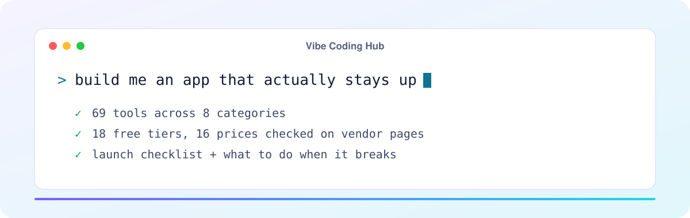
</picture>

<h1 align="center">Vibe Coding Hub</h1>

<p align="center">
  <strong>The tools, the real prices, and the habits that keep an AI-built app working after the demo.</strong><br>
  Free, community-maintained, and checked against vendor pages every month.
</p>

<!-- BEGIN:badges -->

<p align="center">
  
  
  
  <a href="https://vibe-coding.neuralsaasai.com/"></a>
  <a href="https://github.com/NeuralSaasAi/vibe-coding-hub/actions/workflows/ci.yml"></a>
  <a href="CONTRIBUTING.md"></a>
  <a href="LICENSE"></a>
</p>

<!-- END:badges -->

<h3 align="center">
  <a href="https://vibe-coding.neuralsaasai.com/">🌐 Explore the website</a> &nbsp;·&nbsp;
  <a href="#-tools-by-category">🧰 Browse tools</a> &nbsp;·&nbsp;
  <a href="#-pricing-at-a-glance">💸 Compare prices</a> &nbsp;·&nbsp;
  <a href="#4-when-something-breaks">🛟 Fix my app</a>
</h3>

<p align="center">
  <a href="#-free-tools-and-free-tiers">🆓 What's free</a> ·
  <a href="#-which-tool-for-which-job">🎯 Which tool?</a> ·
  <a href="#-the-roadmap">🚦 Roadmap</a> ·
  <a href="#3-before-you-launch">🚀 Launch checklist</a> ·
  <a href="#-community-and-contributing">🤝 Contribute</a>
</p>

## 🧭 Pick your path

| | You are... | Go to |
| :---: | --- | --- |
| 🌱 | **New to this.** You have an idea and have never shipped an app. | [Start here](#-start-here-zero-to-your-first-shipped-app), then [Which tool for which job](#-which-tool-for-which-job) |
| 💸 | **Comparing tools.** You want to know what's free and what it really costs. | [Free tiers](#-free-tools-and-free-tiers) and [Pricing at a glance](#-pricing-at-a-glance) |
| 🚀 | **About to launch.** It works on your screen; you want it safe for real users. | [Ship-ready checklist](#3-before-you-launch) |
| 🔥 | **Something broke.** Login loops, payments don't update, deploy fails. | [When something breaks](#4-when-something-breaks) |
| 🧑‍💻 | **A developer.** You want agents that work in your own codebase. | [AI IDEs](#ai-ides-and-editor-extensions) and [CLI coding agents](#cli-coding-agents) |

## ✨ Why this list

<table>
  <tr>
    <td width="33%" valign="top">
      <h3>📅 Dated prices</h3>
      Every price comes from the vendor's own page and shows the month it was checked. No guessing from old blog posts.
    </td>
    <td width="33%" valign="top">
      <h3>🎯 Honest fit notes</h3>
      Which tool suits which job, and the point where people usually outgrow it.
    </td>
    <td width="33%" valign="top">
      <h3>🛟 Life after the demo</h3>
      How to launch safely, debug calmly and keep an AI-built app healthy as users arrive.
    </td>
  </tr>
</table>

> [!TIP]
> Found a price that changed or a tool we missed? [Open an issue](https://github.com/NeuralSaasAi/vibe-coding-hub/issues/new/choose) or send a pull request. Small fixes are the most useful kind. ⭐ Star the repo to find it again when you need it.

<details>
<summary><b>📖 Full contents</b></summary>

- [Tools at a glance](#-tools-at-a-glance)
- [Categories](#-categories)
- [The roadmap](#-the-roadmap)
- [Start here: zero to your first shipped app](#-start-here-zero-to-your-first-shipped-app)
- [Tools by category](#-tools-by-category)
  - [AI app builders](#ai-app-builders)
  - [AI IDEs and editor extensions](#ai-ides-and-editor-extensions)
  - [CLI coding agents](#cli-coding-agents)
  - [UI and design generators](#ui-and-design-generators)
  - [Backend and database](#backend-and-database)
  - [Auth and payments](#auth-and-payments)
  - [Deploy and hosting](#deploy-and-hosting)
  - [Testing, security and monitoring](#testing-security-and-monitoring)
- [Free tools and free tiers](#-free-tools-and-free-tiers)
- [Pricing at a glance](#-pricing-at-a-glance)
- [Which tool for which job](#-which-tool-for-which-job)
- [Keep your vibe-coded app alive](#-keep-your-vibe-coded-app-alive)
  - [1. Before you build](#1-before-you-build)
  - [2. While you build](#2-while-you-build)
  - [3. Before you launch](#3-before-you-launch)
  - [4. When something breaks](#4-when-something-breaks)
  - [5. After launch](#5-after-launch)
- [Learning resources](#-learning-resources)
- [What's next](#-whats-next)
- [Community and contributing](#-community-and-contributing)
- [Credits](#-credits)
- [Maintained by NeuralSaaS](#-maintained-by-neuralsaas)

</details>

## 👀 Tools at a glance

Every tool in the list, by category. Click a logo to visit the tool, or a category to read the notes. Prefer filters? [Browse them on the website](https://vibe-coding.neuralsaasai.com/tools/).

<!-- BEGIN:glance -->

<table>
  <tr>
    <td><a href="#ai-app-builders"><b>🏗️ AI app builders</b></a></td>
    <td><a href="https://base44.com"></a> <a href="https://bolt.new"></a> <a href="https://emergent.sh"></a> <a href="https://lovable.dev"></a> <a href="https://replit.com"></a> <a href="https://www.rocket.new"></a> <a href="https://same.new"></a> <a href="https://www.tempo.new"></a> <a href="https://v0.app"></a></td>
  </tr>
  <tr>
    <td><a href="#ai-ides-and-editor-extensions"><b>🧑‍💻 AI IDEs and editor extensions</b></a></td>
    <td><a href="https://cline.bot"></a> <a href="https://cursor.com"></a> <a href="https://devin.ai"></a> <a href="https://github.com/features/copilot"></a> <a href="https://antigravity.google"></a> <a href="https://junie.jetbrains.com"></a> <a href="https://kiro.dev"></a> <a href="https://www.trae.ai"></a> <a href="https://zed.dev"></a></td>
  </tr>
  <tr>
    <td><a href="#cli-coding-agents"><b>⌨️ CLI coding agents</b></a></td>
    <td><a href="https://aider.chat"></a> <a href="https://ampcode.com"></a> <a href="https://claude.com/product/claude-code"></a> <a href="https://github.com/openai/codex"></a> <a href="https://github.com/google-gemini/gemini-cli"></a> <a href="https://github.com/github/copilot-cli"></a> <a href="https://block.github.io/goose/"></a> <a href="https://kiro.dev/cli/"></a> <a href="https://opencode.ai"></a></td>
  </tr>
  <tr>
    <td><a href="#ui-and-design-generators"><b>🎨 UI and design generators</b></a></td>
    <td><a href="https://21st.dev"></a> <a href="https://www.figma.com/make/"></a> <a href="https://www.framer.com"></a> <a href="https://stitch.google.com"></a> <a href="https://www.magicpatterns.com"></a> <a href="https://www.relume.ai"></a> <a href="https://ui.shadcn.com"></a> <a href="https://uizard.io"></a></td>
  </tr>
  <tr>
    <td><a href="#backend-and-database"><b>🗄️ Backend and database</b></a></td>
    <td><a href="https://appwrite.io"></a> <a href="https://www.convex.dev"></a> <a href="https://firebase.google.com"></a> <a href="https://neon.com"></a> <a href="https://pocketbase.io"></a> <a href="https://supabase.com"></a> <a href="https://turso.tech"></a></td>
  </tr>
  <tr>
    <td><a href="#auth-and-payments"><b>🔐 Auth and payments</b></a></td>
    <td><a href="https://authjs.dev"></a> <a href="https://better-auth.com"></a> <a href="https://clerk.com"></a> <a href="https://www.kinde.com"></a> <a href="https://www.lemonsqueezy.com"></a> <a href="https://www.paddle.com"></a> <a href="https://polar.sh"></a> <a href="https://stripe.com"></a> <a href="https://workos.com"></a></td>
  </tr>
  <tr>
    <td><a href="#deploy-and-hosting"><b>🚀 Deploy and hosting</b></a></td>
    <td><a href="https://www.cloudflare.com/products/workers/"></a> <a href="https://coolify.io"></a> <a href="https://expo.dev"></a> <a href="https://firebase.google.com/docs/app-hosting"></a> <a href="https://fly.io"></a> <a href="https://www.netlify.com"></a> <a href="https://railway.com"></a> <a href="https://render.com"></a> <a href="https://vercel.com"></a></td>
  </tr>
  <tr>
    <td><a href="#testing-security-and-monitoring"><b>🛡️ Testing, security and monitoring</b></a></td>
    <td><a href="https://www.coderabbit.ai"></a> <a href="https://docs.github.com/en/code-security/how-tos/secure-your-supply-chain"></a> <a href="https://github.com/gitleaks/gitleaks"></a> <a href="https://playwright.dev"></a> <a href="https://posthog.com"></a> <a href="https://semgrep.dev"></a> <a href="https://sentry.io"></a> <a href="https://uptimerobot.com"></a> <a href="https://vitest.dev"></a></td>
  </tr>
</table>

<!-- END:glance -->

## 📦 Categories

<!-- BEGIN:gallery -->

<table>
  <tr>
    <td width="33%" align="center"><a href="https://vibe-coding.neuralsaasai.com/tools/?category=ai-app-builders">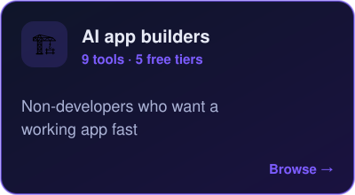</a></td>
    <td width="33%" align="center"><a href="https://vibe-coding.neuralsaasai.com/tools/?category=ai-ides">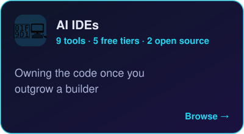</a></td>
    <td width="33%" align="center"><a href="https://vibe-coding.neuralsaasai.com/tools/?category=cli-agents">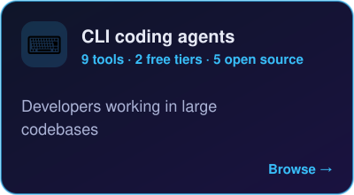</a></td>
  </tr>
  <tr>
    <td width="33%" align="center"><a href="https://vibe-coding.neuralsaasai.com/tools/?category=ui-design">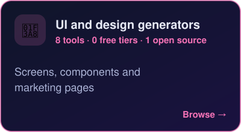</a></td>
    <td width="33%" align="center"><a href="https://vibe-coding.neuralsaasai.com/tools/?category=backend-database">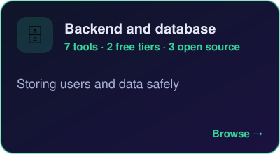</a></td>
    <td width="33%" align="center"><a href="https://vibe-coding.neuralsaasai.com/tools/?category=auth-payments">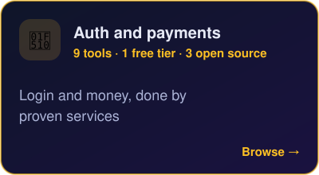</a></td>
  </tr>
  <tr>
    <td width="33%" align="center"><a href="https://vibe-coding.neuralsaasai.com/tools/?category=deploy-hosting">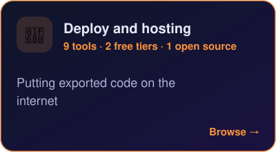</a></td>
    <td width="33%" align="center"><a href="https://vibe-coding.neuralsaasai.com/tools/?category=testing-monitoring">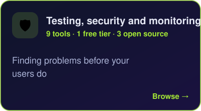</a></td>
  </tr>
</table>

<!-- END:gallery -->

## 🚦 The roadmap

Five stages from first prompt to a healthy live app. Click a stage to open it on the [interactive roadmap](https://vibe-coding.neuralsaasai.com/roadmap/), where you can tick off each checklist, or read the full guide [below](#-keep-your-vibe-coded-app-alive).

<!-- BEGIN:roadmap -->

<p align="center">
  <a href="https://vibe-coding.neuralsaasai.com/roadmap/#before-you-build">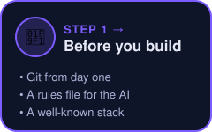</a>
  <a href="https://vibe-coding.neuralsaasai.com/roadmap/#while-you-build">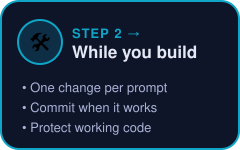</a>
  <a href="https://vibe-coding.neuralsaasai.com/roadmap/#before-you-launch">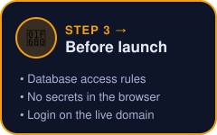</a>
  <a href="https://vibe-coding.neuralsaasai.com/roadmap/#when-something-breaks">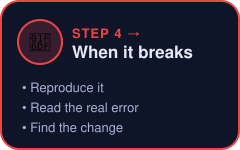</a>
  <a href="https://vibe-coding.neuralsaasai.com/roadmap/#after-launch">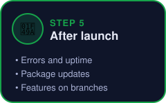</a>
</p>

<!-- END:roadmap -->

<p align="right"><a href="#top">↑ back to top</a></p>

## 🌱 Start here: zero to your first shipped app

<p align="center">
  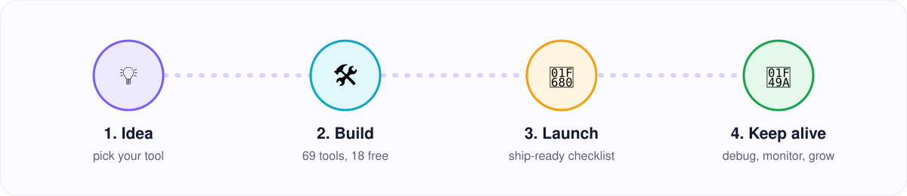
</p>

You do not need to know how to code to start. You do need a few habits. This path takes most people from an idea to a live app.

1. **Write down the idea in one page.** Who is it for, what problem does it solve, and what are the 3 to 5 things a user must be able to do? This becomes your first prompt and keeps the AI focused.
2. **Pick one builder and stay with it for the first version.** If you have never coded, start with an [AI app builder](#ai-app-builders). If you are comfortable with files and a terminal, try an [AI IDE](#ai-ides-and-editor-extensions) or a [CLI agent](#cli-coding-agents). Use [Which tool for which job](#-which-tool-for-which-job) to choose.
3. **Build in small steps.** Ask for one screen or one feature at a time, check it works, then move on. Read [While you build](#2-while-you-build) before your first session.
4. **Add a real backend and login when you need saved data.** Most builders connect to [Supabase](https://supabase.com) or [Firebase](https://firebase.google.com), or ship their own. Turn on access rules from day one. See [Before you launch](#3-before-you-launch).
5. **Connect GitHub.** It gives you history, backups and a way to undo mistakes. Most builders offer one-click GitHub sync.
6. **Deploy.** Use your builder's publish button or a host from [Deploy and hosting](#deploy-and-hosting). Run through the [launch checklist](#3-before-you-launch) first.
7. **Watch it and keep it healthy.** Add error tracking and uptime checks from [Testing, security and monitoring](#testing-security-and-monitoring). See [After launch](#5-after-launch).

## 🧰 Tools by category

Tags: `Free tier` means we confirmed a free plan on the vendor's site. `Open source` means the code is public. No tag means not yet verified. Each category shows three picks first; open the list for the rest.

<!-- BEGIN:tools -->

### AI app builders

Describe the app in plain language and get a working web app, usually with hosting included. Best for non-developers and fast prototypes.

- [Bolt](https://bolt.new) - Builds full-stack web and mobile apps in the browser, with hosting and databases included. `Free tier`
- [Lovable](https://lovable.dev) - Prompt-to-web-app builder with its own Cloud backend, GitHub sync and one-click publishing. `Free tier`
- [Replit](https://replit.com) - Browser workspace with an Agent that builds, hosts and deploys apps, databases included. `Free tier`

<details>
<summary>6 more ai app builders</summary>

- [Base44](https://base44.com) - Chat-to-app builder with a built-in database, login and hosting. Suits internal tools and simple SaaS. `Free tier`
- [Emergent](https://emergent.sh) - Agent-based builder for full-stack web and mobile apps from a prompt.
- [Rocket](https://www.rocket.new) - Prompt-to-app builder for web and mobile apps.
- [Same](https://same.new) - Rebuilds and edits web interfaces from a prompt or an existing site.
- [Tempo](https://www.tempo.new) - Visual editor plus AI for React apps, aimed at designers and product people.
- [v0](https://v0.app) - Vercel's builder for React and Next.js apps, with one-click deploys to Vercel. `Free tier`

</details>

### AI IDEs and editor extensions

A code editor with an AI agent built in. You see and own every file. Best once your app outgrows a builder, or if you already code.

- [Cursor](https://cursor.com) - VS Code-based AI editor with agent mode, tab completion and cloud agents. Now sold as part of The X Subscription. `Free tier`
- [GitHub Copilot](https://github.com/features/copilot) - AI assistant and agent across VS Code, JetBrains, GitHub.com and the terminal. `Free tier`
- [Kiro](https://kiro.dev) - Agentic IDE and CLI with spec-driven development (requirements, design, tasks), steering files and hooks. `Free tier`

<details>
<summary>6 more ai ides and editor extensions</summary>

- [Cline](https://cline.bot) - VS Code agent that plans, edits files and runs commands, asking before each step. `Open source`
- [Devin (formerly Windsurf)](https://devin.ai) - Cognition's AI editor and cloud agent. windsurf.com now redirects here. `Free tier`
- [Google Antigravity](https://antigravity.google) - Google's agent-first editor built around Gemini models. `Free tier`
- [JetBrains Junie](https://junie.jetbrains.com) - Coding agent inside JetBrains IDEs such as IntelliJ and PyCharm.
- [Trae](https://www.trae.ai) - AI IDE with chat and builder modes.
- [Zed](https://zed.dev) - Fast editor with built-in AI agent support. `Open source`

</details>

### CLI coding agents

Agents that run in your terminal, read your whole project and make changes. Best for developers and larger codebases.

- [Aider](https://aider.chat) - Terminal pair programmer that edits files in your git repo and commits each change, so every step is easy to undo. `Open source`
- [Claude Code](https://claude.com/product/claude-code) - Anthropic's agent that reads your codebase, edits files and runs commands. Included with Claude Pro and above.
- [Codex CLI](https://github.com/openai/codex) - OpenAI's terminal agent. Sign in with a ChatGPT plan (including Free) or use an API key. `Free tier` `Open source`

<details>
<summary>6 more cli coding agents</summary>

- [Amp](https://ampcode.com) - Coding agent for the terminal and editor.
- [Gemini CLI](https://github.com/google-gemini/gemini-cli) - Google's terminal agent, now aimed at Gemini Code Assist business users. Free individual access moved to Antigravity CLI in June 2026. `Open source`
- [GitHub Copilot CLI](https://github.com/github/copilot-cli) - Copilot in your terminal. Works on the Copilot Free plan. `Free tier`
- [Goose](https://block.github.io/goose/) - Local agent that works with many model providers and MCP tools. `Open source`
- [Kiro CLI](https://kiro.dev/cli/) - Kiro's agent in the terminal, using the same steering files and specs as the IDE.
- [OpenCode](https://opencode.ai) - Terminal agent that works with many model providers. `Open source`

</details>

### UI and design generators

Turn a prompt, sketch or screenshot into screens and components.

- [Figma Make](https://www.figma.com/make/) - Prompt-to-prototype inside Figma.
- [Framer](https://www.framer.com) - Website builder with AI page generation and hosting. Good for marketing sites.
- [shadcn/ui](https://ui.shadcn.com) - Copy-paste React components that many AI builders use by default. Knowing the names helps you prompt better. `Open source`

<details>
<summary>5 more ui and design generators</summary>

- [21st.dev](https://21st.dev) - Community library of React and Tailwind components, each with a prompt you can paste into your AI tool.
- [Google Stitch](https://stitch.google.com) - Generates UI designs and front-end code from prompts or images.
- [Magic Patterns](https://www.magicpatterns.com) - AI prototyping for product teams.
- [Relume](https://www.relume.ai) - AI sitemaps and wireframes for marketing websites.
- [Uizard](https://uizard.io) - Turns sketches and screenshots into editable mockups.

</details>

### Backend and database

Where your users and data live. Pick one your builder supports well.

- [Convex](https://www.convex.dev) - TypeScript backend with a real-time database.
- [Firebase](https://firebase.google.com) - Google's backend platform with login, Firestore database, storage and hosting. `Free tier`
- [Supabase](https://supabase.com) - Postgres with login, storage, edge functions and Row Level Security. Widely used with Lovable, Bolt and v0 apps. `Free tier` `Open source`

<details>
<summary>4 more backend and database</summary>

- [Appwrite](https://appwrite.io) - Backend with login, database, storage and functions. Cloud or self-hosted. `Open source`
- [Neon](https://neon.com) - Serverless Postgres with database branching for safe testing.
- [PocketBase](https://pocketbase.io) - Single-file backend with SQLite, login and an admin dashboard. `Open source`
- [Turso](https://turso.tech) - SQLite-based database built for the edge.

</details>

### Auth and payments

Login and money are where small mistakes hurt most. Use a proven service instead of asking the AI to invent one.

- [Better Auth](https://better-auth.com) - TypeScript login library with plugins for 2FA, organizations and more. `Open source`
- [Clerk](https://clerk.com) - Hosted login with ready-made sign-in and profile screens. `Free tier`
- [Stripe](https://stripe.com) - Payments, subscriptions and invoicing, priced per transaction.

<details>
<summary>6 more auth and payments</summary>

- [Auth.js](https://authjs.dev) - Login library for Next.js and other JavaScript frameworks. `Open source`
- [Kinde](https://www.kinde.com) - Hosted login with built-in feature flags and billing.
- [Lemon Squeezy](https://www.lemonsqueezy.com) - Merchant of record for software and digital products. Handles sales tax for you.
- [Paddle](https://www.paddle.com) - Merchant of record for SaaS subscriptions.
- [Polar](https://polar.sh) - Merchant of record for developers selling digital products and subscriptions. `Open source`
- [WorkOS](https://workos.com) - Enterprise login (SSO, directory sync) for when business customers ask for it.

</details>

### Deploy and hosting

Put your app on the internet. Many builders include hosting; these are for when you export your code.

- [Cloudflare Workers](https://www.cloudflare.com/products/workers/) - Run sites and APIs on Cloudflare's global network.
- [Netlify](https://www.netlify.com) - Git-based hosting with deploy previews, functions and forms. `Free tier`
- [Vercel](https://vercel.com) - Hosting from the makers of Next.js, with preview deploys and instant rollback. `Free tier`

<details>
<summary>6 more deploy and hosting</summary>

- [Coolify](https://coolify.io) - Self-hosted alternative to Vercel and Netlify on your own server. `Open source`
- [Expo](https://expo.dev) - Builds and submits React Native apps to the App Store and Google Play.
- [Firebase App Hosting](https://firebase.google.com/docs/app-hosting) - Hosting for Next.js and Angular apps on Google Cloud.
- [Fly.io](https://fly.io) - Run full apps and databases close to your users.
- [Railway](https://railway.com) - Deploy apps, databases and background workers from GitHub.
- [Render](https://render.com) - Hosting for web services, databases and cron jobs.

</details>

### Testing, security and monitoring

The tools that tell you something broke before your users do.

- [Gitleaks](https://github.com/gitleaks/gitleaks) - Scans your repo for leaked passwords and API keys. `Open source`
- [Playwright](https://playwright.dev) - Automated browser tests. Can record a test while you click through your app. `Open source`
- [Sentry](https://sentry.io) - Error tracking that shows which line failed and for which user. `Free tier`

<details>
<summary>6 more testing, security and monitoring</summary>

- [CodeRabbit](https://www.coderabbit.ai) - AI reviews on every pull request.
- [Dependabot](https://docs.github.com/en/code-security/how-tos/secure-your-supply-chain) - Free on GitHub. Opens pull requests when your packages have security fixes.
- [PostHog](https://posthog.com) - Product analytics, session replay and feature flags.
- [Semgrep](https://semgrep.dev) - Code scanning for security issues.
- [UptimeRobot](https://uptimerobot.com) - Alerts you when your site goes down.
- [Vitest](https://vitest.dev) - Fast unit tests for JavaScript and TypeScript projects. `Open source`

</details>

<!-- END:tools -->

<p align="right"><a href="#top">↑ back to top</a></p>

## 🆓 Free tools and free tiers

<!-- BEGIN:free-tiers -->

What you get for $0. Checked on each vendor's page in 2026-11. Free plans change often, so check the source before you rely on a limit.

| Tool | What's free | Main limits | Source |
| --- | --- | --- | --- |
| Base44 | Core features, up to 5 apps | 25 message credits and 100 integration credits a month | [Pricing](https://base44.com/pricing) |
| Bolt | Public and private projects, hosting, databases | 1M tokens a month, 300K a day; Bolt branding on sites | [Pricing](https://bolt.new/pricing) |
| ChatGPT (Codex) | Codex for quick coding tasks | Smaller model; limited usage | [Codex pricing](https://learn.chatgpt.com/docs/pricing) |
| Claude | Chat, artifacts, file creation | Claude Code needs Pro or above | [Pricing](https://claude.com/pricing) |
| Clerk | Hosted login, unlimited apps | 50,000 monthly retained users per app | [Pricing](https://clerk.com/pricing) |
| Cursor | Editor with agent | Limited agent and chat requests | [Pricing](https://cursor.com/pricing) |
| Devin (formerly Windsurf) | Editor, unlimited Tab completions and inline edits | Light agent quota, limited models | [Pricing](https://devin.ai/pricing) |
| Firebase (Spark) | Login, Firestore, hosting | 50K monthly active users; Firestore 1 GiB, 50K reads and 20K writes a day | [Pricing](https://firebase.google.com/pricing) |
| GitHub Copilot | Editor, CLI and agent mode | Limited chat and agent usage | [Plans](https://github.com/features/copilot/plans) |
| Google Antigravity | Agent models, unlimited Tab | Basic weekly rate limits | [Pricing](https://antigravity.google/pricing) |
| Kiro | IDE and CLI | 50 credits a month | [Billing docs](https://kiro.dev/docs/billing/) |
| Lovable | Building, Cloud hosting, GitHub sync | 5 build credits a day, up to 30 a month; no code editing, no custom domain | [Plans](https://docs.lovable.dev/introduction/subscription-plans) |
| Netlify | Deploys, functions, custom domains | 300 credits a month | [Pricing](https://www.netlify.com/pricing/) |
| Replit (Starter) | Agent in Lite mode, 1 published app | Daily Agent credits with a monthly cap; free app goes offline after 30 days | [Starter plan](https://docs.replit.com/billing/plans/starter-plan) |
| Sentry (Developer) | Error tracking | 1 user, 30-day lookback | [Pricing](https://sentry.io/pricing/) |
| Supabase | Database, login, storage | 500 MB database, 2 active projects; paused after 1 week without activity | [Pricing](https://supabase.com/pricing) |
| v0 | Building and deploying | 7 messages a day; free credits depend on current signup offer | [Pricing docs](https://v0.app/docs/pricing) |
| Vercel (Hobby) | Hosting and preview deploys | 1M CDN requests and 100 GB data transfer a month | [Pricing](https://vercel.com/pricing) |

<!-- END:free-tiers -->

Open-source tools in this list (Aider, Cline, Codex CLI, OpenCode, Playwright and others) are free to use. You still pay for the AI model they call unless you sign in with a plan that covers it.

<p align="right"><a href="#top">↑ back to top</a></p>

## 💸 Pricing at a glance

Monthly prices in USD, before tax, billed monthly unless noted. Most AI tools now bill by credits, tokens or usage pools, so your real cost depends on how much you build. Prices change often: if one is wrong, please [send a pricing update](https://github.com/NeuralSaasAi/vibe-coding-hub/issues/new?template=pricing-update.yml).

<p align="center">
  <a href="https://vibe-coding.neuralsaasai.com/pricing/"><picture>
    <source media="(prefers-color-scheme: dark)" srcset="assets/pricing-chart-dark.svg">
    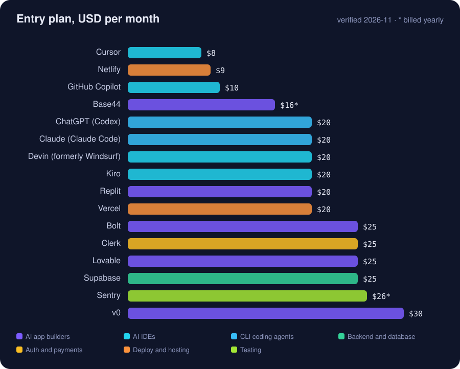
  </picture></a>
</p>

<p align="center"><a href="https://vibe-coding.neuralsaasai.com/pricing/">Sort and compare on the website →</a></p>

<!-- BEGIN:pricing -->

| Tool | Free plan | Entry paid plan | Higher plans | How usage is measured | Source | Last verified |
| --- | --- | --- | --- | --- | --- | --- |
| Base44 | Yes | Starter $16 (billed yearly) | Builder $40, Pro $80, Elite $160 (billed yearly) | Message and integration credits | [Pricing](https://base44.com/pricing) | 2026-11 |
| Bolt | Yes | Pro $25 (10M tokens) | Teams $30 per member; Enterprise custom | Tokens; unused tokens roll over | [Pricing](https://bolt.new/pricing) | 2026-11 |
| ChatGPT (Codex) | Yes | Plus $20 | Pro $100 or $200; Business per seat | Shared usage limits, then credits | [Codex pricing](https://learn.chatgpt.com/docs/pricing), [Plus](https://help.openai.com/en/articles/6950777-what-is-chatgpt-plus) | 2026-11 |
| Claude (Claude Code) | Chat only | Pro $20 ($17 billed yearly) | Max $100, Ultra $200 | Limits every 5 hours and every week | [Pricing](https://claude.com/pricing) | 2026-11 |
| Clerk | Yes | Pro $25 ($20 billed yearly) | Business $300 | Monthly retained users | [Pricing](https://clerk.com/pricing) | 2026-11 |
| Cursor | Yes | Plus $8 (Grok models only) | Premium $30, Super $100, Ultra $200; Teams from $30 per user | Usage pool shared with Grok; third-party models billed at API prices | [Pricing](https://cursor.com/pricing) | 2026-11 |
| Devin (formerly Windsurf) | Yes | Pro $20 | Max $200; Teams $80 plus $40 per seat | Daily and weekly quotas | [Pricing](https://devin.ai/pricing) | 2026-11 |
| GitHub Copilot | Yes | Pro $10 | Pro+ $39, Max $100 | GitHub AI Credits | [Plans](https://github.com/features/copilot/plans) | 2026-11 |
| Kiro | Yes (50 credits) | Pro $20 (1,000 credits) | Pro+ $40 (2,000), Pro Max $100 (5,000), Power $200 (10,000) | Credits | [Billing docs](https://kiro.dev/docs/billing/) | 2026-11 |
| Lovable | Yes | Pro $25 (100 credits) | Business $50; Enterprise custom | One credit balance for building, hosting and in-app AI | [Pricing](https://lovable.dev/pricing) | 2026-11 |
| Netlify | Yes | Personal $9 | Pro $20 with unlimited members | Credits | [Pricing](https://www.netlify.com/pricing/) | 2026-11 |
| Replit | Yes (Starter) | Core $20 ($18 billed yearly) | Pro $100 ($90 billed yearly), up to 15 builders | Credits; Agent billed by effort | [Pricing](https://replit.com/pricing) | 2026-11 |
| Sentry | Yes | Team $26 (billed yearly) | Business $80 (billed yearly) | Errors and data volume | [Pricing](https://sentry.io/pricing/) | 2026-11 |
| Supabase | Yes | Pro from $25 plus compute ($10 compute credit included) | Team from $599 | Per organization, plus compute per project | [Pricing](https://supabase.com/pricing) | 2026-11 |
| v0 | Yes | Plus $30 per user ($30 credits) | Business $100 per user; Enterprise custom | Dollar credits, plus $2 daily login credit on paid plans | [Pricing docs](https://v0.app/docs/pricing) | 2026-11 |
| Vercel | Yes (Hobby) | Pro $20 | Enterprise custom | Included usage, then pay as you go | [Pricing](https://vercel.com/pricing) | 2026-11 |

<!-- END:pricing -->

> [!TIP]
> **Budget tip:** the plan fee is only part of the cost. AI builders spend credits on every change, including fixes, and hosted backends charge for data and compute once you have users. Set a usage alert wherever the tool offers one.

<p align="right"><a href="#top">↑ back to top</a></p>

## 🎯 Which tool for which job

<!-- BEGIN:jobs -->

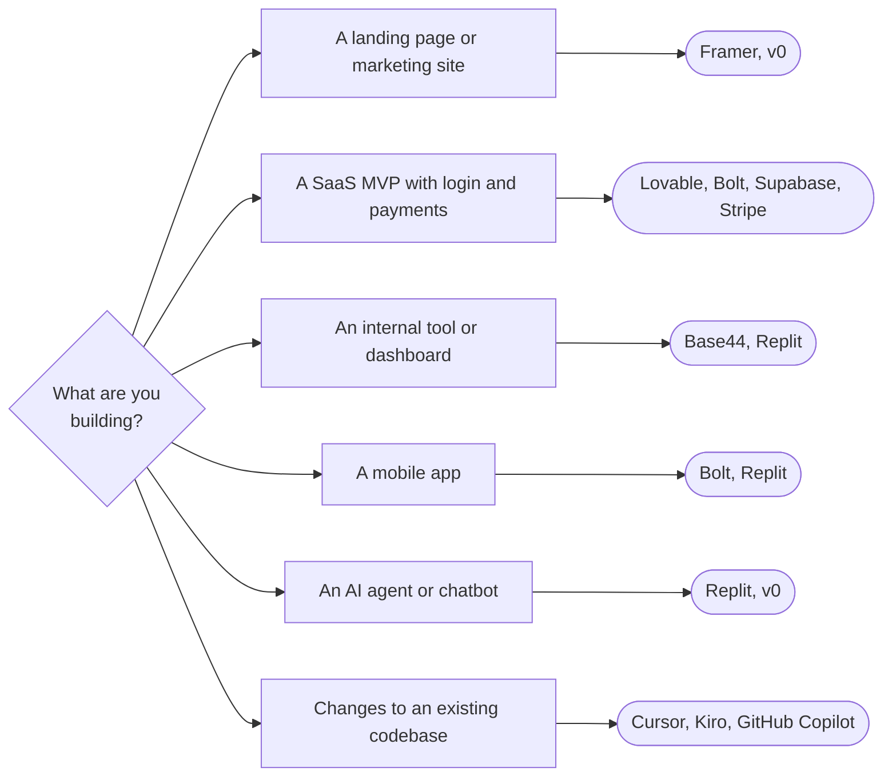

A starting point, not a ranking. Any of these tools can build most apps. The question is how much control you want and when you will need more.

| I want to build... | Good first pick | Also consider | Where people tend to outgrow it |
| --- | --- | --- | --- |
| A landing page or marketing site | [Framer](https://www.framer.com), [v0](https://v0.app) | [Lovable](https://lovable.dev), [Relume](https://www.relume.ai) for the wireframe | Rarely. Move on only if you need custom app logic behind the site. |
| A SaaS MVP with login and payments | [Lovable](https://lovable.dev) or [Bolt](https://bolt.new), with [Supabase](https://supabase.com) and [Stripe](https://stripe.com) | [Replit](https://replit.com), [v0](https://v0.app), [Base44](https://base44.com) | Complex business rules, background jobs, many user roles. Sync to GitHub and continue in an [AI IDE](#ai-ides-and-editor-extensions). |
| An internal tool or dashboard | [Base44](https://base44.com), [Replit](https://replit.com) | [Lovable](https://lovable.dev), [Convex](https://www.convex.dev) for live data | Large data sets and strict permissions. |
| A mobile app | [Bolt](https://bolt.new), [Replit](https://replit.com) | [Emergent](https://emergent.sh), [Rocket](https://www.rocket.new) | App store releases and native device features. Move to [Expo](https://expo.dev) with an AI IDE. |
| An AI agent or chatbot | [Replit](https://replit.com), [v0](https://v0.app) | [Lovable](https://lovable.dev), [Claude Code](https://claude.com/product/claude-code) or [Codex CLI](https://github.com/openai/codex) for custom logic | Cost control and answer quality at scale. You will need logging and tests. |
| Changes to an existing codebase | [Cursor](https://cursor.com), [Kiro](https://kiro.dev), [GitHub Copilot](https://github.com/features/copilot) | [Claude Code](https://claude.com/product/claude-code), [Codex CLI](https://github.com/openai/codex), [Aider](https://aider.chat), [Cline](https://cline.bot) | These are the tools people grow into. |

<!-- END:jobs -->

Not sure yet? Answer three questions with the [which-tool finder](https://vibe-coding.neuralsaasai.com/which-tool/).

<p align="right"><a href="#top">↑ back to top</a></p>

## 🛟 Keep your vibe-coded app alive

Getting the first version working is the fun part. Keeping it working while you add features, get users and fix problems is where most projects stall. Nobody gets this right the first time. These habits make it much easier, whichever tool you use.

> [!IMPORTANT]
> In a [2025 study by Veracode](https://www.veracode.com/blog/genai-code-security-report), AI-generated code failed security tests in 45% of tasks. That is not a reason to stop. It means you need a short checklist and a few safety nets.

<!-- BEGIN:guide -->

### 1. Before you build

Set things up so mistakes are cheap.

- **Use git from day one.** Git saves a snapshot of your project every time you commit, so you can always go back. Connect your builder to GitHub, or use [GitHub Desktop](https://github.com/apps/desktop) if the terminal feels unfamiliar. Learn more in [Pro Git: About version control](https://git-scm.com/book/en/v2/Getting-Started-About-Version-Control).
- **Give the AI a rules file.** A short file that describes your app, your stack and your rules ("never change the database schema without asking", "use the existing components") stops the AI from guessing each session. Each tool has its own version: [Cursor rules](https://cursor.com/docs/rules), [Claude Code memory](https://code.claude.com/docs/en/memory), [Kiro steering](https://kiro.dev/docs/steering/), and the cross-tool [AGENTS.md](https://agents.md) format.
- **Choose a common, well-documented stack.** AI tools write better code for popular tools such as React, Next.js, Supabase and Stripe, because they have seen far more examples. Avoid niche libraries in your first app.
- **Keep secrets out of your code.** API keys and passwords belong in environment variables, not in files the AI writes. See [Next.js environment variables](https://nextjs.org/docs/app/guides/environment-variables) or [Vite env variables](https://vite.dev/guide/env-and-mode).

> [!WARNING]
> Anything starting with `NEXT_PUBLIC_` or `VITE_` is sent to every visitor's browser. Only public keys belong there. Supabase explains which of its keys are safe in the browser and which are not in [Understanding API keys](https://supabase.com/docs/guides/getting-started/api-keys).

### 2. While you build

Habits that stop small changes from turning into big messes.

- **One change per prompt.** "Add a settings page" works better than "add settings, fix the header and change the colors". Smaller changes are easier to check and to undo. Anthropic's [Claude Code best practices](https://code.claude.com/docs/en/best-practices) recommend asking the agent to plan first, then implement.
- **Commit after every step that works.** If the next prompt breaks something, you lose minutes, not days.
- **Protect code that already works.** Tell the AI which files or features not to touch. If it starts rewriting large parts of the app to fix a small problem, stop and undo.
- **Ask the AI to explain before you accept.** "What did you change and why?" catches surprises like deleted features, new packages or database changes.
- **Never let an agent work directly on your live data.** Use a separate development database. In July 2025 an AI agent [deleted a live production database](https://www.theregister.com/software/2025/07/21/vibe-coding-service-replit-deleted-production-database/719783) during a code freeze. Replit later [restored the data and added safeguards](https://www.fastcompany.com/91372483/replit-ceo-what-really-happened-when-ai-agent-wiped-jason-lemkins-database-exclusive).

> [!WARNING]
> When a new feature breaks an old one, the cause is usually a shared file the AI changed along the way. Compare the last working commit with the current one before asking for another fix.

### 3. Before you launch

A ship-ready checklist. Ask your AI tool to check each item, then verify it yourself.

- [ ] **Database access rules are on for every table.** Each user should only read and change their own data. Supabase calls this [Row Level Security](https://supabase.com/docs/guides/database/postgres/row-level-security); Firebase uses [Security Rules](https://firebase.google.com/docs/rules). Run the Supabase [Security Advisor](https://supabase.com/docs/guides/observability/advisors) before you launch.
- [ ] **No secret keys in browser code.** Search your code for `sk_`, `service_role` and `secret`. Turn on GitHub [secret scanning](https://docs.github.com/en/code-security/concepts/secret-security/secret-scanning) or run [Gitleaks](https://github.com/gitleaks/gitleaks).
- [ ] **Login works end to end on the live domain.** Sign up, confirm email, log out, log in and reset a password on the real URL, not just the preview.
- [ ] **Payments are confirmed by webhooks, not by the browser.** Your server should mark an order as paid only after Stripe tells it so. See [Stripe webhooks](https://docs.stripe.com/webhooks) and [verify the signature](https://docs.stripe.com/webhooks/signature).
- [ ] **Error and 404 pages exist.** Users should never see a blank screen or a stack trace.
- [ ] **Backups are on, and you know how to restore one.** See [Supabase backups](https://supabase.com/docs/guides/platform/backups).
- [ ] **A staging or preview environment exists.** Try changes there first. Most hosts create a preview link for every branch.
- [ ] **Basic security review.** Skim the [OWASP Top 10](https://owasp.org/Top10/) and ask your AI tool to check the app against it.

> [!WARNING]
> Missing access rules are the most common serious problem in AI-built apps. In 2025, researchers found 170 apps built with one popular builder that exposed user data this way ([CVE-2025-48757](https://nvd.nist.gov/vuln/detail/CVE-2025-48757)). Turning on Row Level Security without writing policies blocks everything, so test with two real accounts.

> [!WARNING]
> Login that works in preview but loops or fails on your real domain usually means the domain is missing from your auth provider's allowed redirect URLs. See [Supabase redirect URLs](https://supabase.com/docs/guides/auth/redirect-urls).

> [!WARNING]
> If payments succeed in Stripe but your app never updates, the webhook is usually pointing at the wrong URL, using a test-mode secret in live mode, or failing signature checks. Test locally with the [Stripe CLI](https://docs.stripe.com/stripe-cli).

### 4. When something breaks

It will happen, and it is fixable. Use the same calm method every time, whatever tool you use.

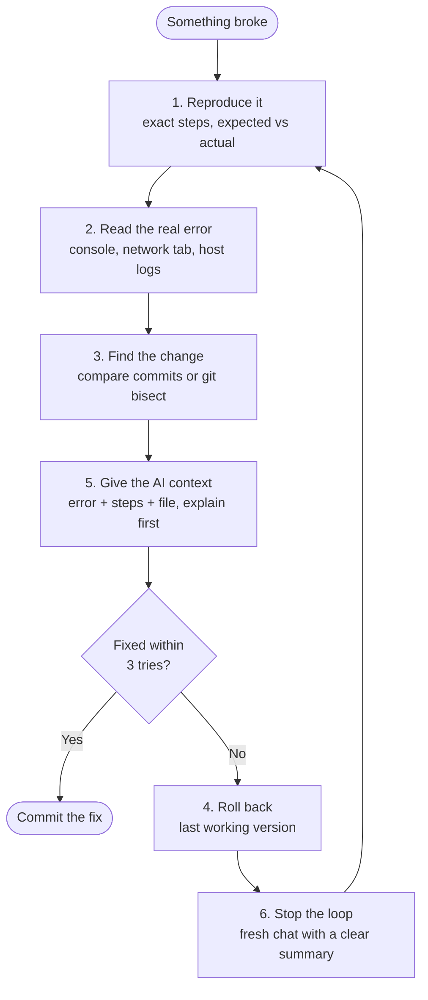

1. **Reproduce it.** Write down the exact steps, what you expected and what happened. If you cannot make it happen again, you cannot confirm a fix.
2. **Read the real error.** Open your browser's [developer console](https://developer.chrome.com/docs/devtools/console) and [network tab](https://developer.chrome.com/docs/devtools/network), and check your host's logs. The error message is usually more useful than the symptom.
3. **Find the change that caused it.** Ask "what changed since it last worked?" Compare commits, or use [git bisect](https://git-scm.com/docs/git-bisect) to find the exact commit.
4. **Roll back if you are stuck.** Restoring the last working version is a valid fix while you investigate. Use your host's rollback (for example [Vercel instant rollback](https://vercel.com/docs/instant-rollback)) or [git revert](https://git-scm.com/docs/git-revert).
5. **Give the AI the right context.** Paste the exact error, the steps to reproduce and the relevant file. Ask it to explain the cause before it changes anything.
6. **Stop the loop.** If three attempts have not fixed it, stop prompting. Each new attempt can add more changes on top of the problem. Roll back, then try a fresh conversation with a clear summary.

Copy-paste prompts:

```text
Here is an error from my app: [paste error]. Steps to reproduce: [steps].
Before changing any code, explain what is causing this and which files are involved.
```

```text
This worked at commit [hash or description] and broke after [change].
Compare the two and tell me which change caused the problem. Do not edit anything yet.
```

```text
Fix only this issue. Do not change unrelated files, rename things or add new packages.
After the fix, list every file you changed and why.
```

> [!WARNING]
> If your app builds on your computer or in preview but fails on deploy, check for missing environment variables on the host and package version differences first. See [Vercel: troubleshoot a build](https://vercel.com/docs/deployments/troubleshoot-a-build).

### 5. After launch

Keeping a live app healthy.

- **Track errors and uptime.** Add [Sentry](https://sentry.io) or a similar tool so you learn about errors from alerts, not angry emails. Add an uptime monitor such as [UptimeRobot](https://uptimerobot.com).
- **Keep packages updated.** Turn on [Dependabot](https://docs.github.com/en/code-security/how-tos/secure-your-supply-chain) so GitHub opens a pull request when a package has a security fix. Update one thing at a time and test.
- **Add features on a branch.** Work on a separate [branch](https://docs.github.com/en/pull-requests/collaborating-with-pull-requests/proposing-changes-to-your-work-with-pull-requests/about-branches), test on its preview link, then merge.
- **Add a few tests for what matters most.** Sign-up, login and checkout are worth protecting. [Playwright codegen](https://playwright.dev/docs/codegen) records a test while you click through the app, and your AI tool can help turn it into a repeatable check.
- **Plan for real data.** Apps that feel fast with ten records can slow down with ten thousand. Load data in pages instead of all at once, and add database indexes on columns you filter by. See [Supabase query optimization](https://supabase.com/docs/guides/database/query-optimization) and [PostgreSQL indexes](https://www.postgresql.org/docs/current/indexes.html).
- **Know when to bring in a developer.** Consider it when you are handling payments or sensitive data at scale, when the same bug keeps coming back, or when every new feature breaks an old one.

> [!WARNING]
> A slow app is usually caused by loading every row on each page view, or by one database query running inside a loop. Ask your AI tool to list every database query on the slow page before it tries a fix.

<!-- END:guide -->

Prefer a step-by-step view? [Debug it on the website](https://vibe-coding.neuralsaasai.com/when-it-breaks/), with copy buttons for each prompt.

**Stuck? [Get a free review of your vibe-coded app](https://neuralsaasai.com/contact?utm_source=github&utm_medium=readme&utm_campaign=vibe-coding-hub&utm_content=keep-alive-guide).**

<p align="right"><a href="#top">↑ back to top</a></p>

## 📚 Learning resources

- [Missing Semester (MIT)](https://missing.csail.mit.edu) - Free lessons on the terminal, git and debugging. The skills that make AI tools far more useful.
- [freeCodeCamp](https://www.freecodecamp.org) - Free courses on web development basics.
- [DeepLearning.AI short courses](https://www.deeplearning.ai/short-courses/) - Free short courses on building with AI, including coding agents.
- [Claude Code best practices](https://code.claude.com/docs/en/best-practices) - Anthropic's guide to working with coding agents. Much of it applies to any tool.
- [Not all AI-assisted programming is vibe coding](https://simonwillison.net/2025/Mar/19/vibe-coding/) - Simon Willison on when vibe coding is fine and when you need to review the code.
- [OWASP Top 10 for LLM applications](https://genai.owasp.org/llm-top-10/) - Security risks to know if your app calls an AI model.
- [Vibe coding on Wikipedia](https://en.wikipedia.org/wiki/Vibe_coding) - Where the term came from and how it is used.
- Official docs worth bookmarking: [Lovable](https://docs.lovable.dev), [Replit](https://docs.replit.com), [v0](https://v0.app/docs), [Supabase](https://supabase.com/docs), [Stripe](https://docs.stripe.com).
- Communities: [r/vibecoding](https://www.reddit.com/r/vibecoding/), [r/lovable](https://www.reddit.com/r/lovable/), [r/cursor](https://www.reddit.com/r/cursor/).

## 🔭 What's next

- [x] Tool directory, free tiers and dated pricing
- [x] Keep your vibe-coded app alive guide
- [x] Tool data in YAML, with the README built from it
- [x] [A visual website for the list](https://vibe-coding.neuralsaasai.com/)
- [ ] Showcase your vibe-coded product: a place to share what you built, with a link and screenshots ([#1](https://github.com/NeuralSaasAi/vibe-coding-hub/issues/1))
- [ ] Platform-specific launch checklists (Lovable, Bolt, Replit, v0)
- [ ] Monthly pricing re-check

Have an idea? [Open an issue](https://github.com/NeuralSaasAi/vibe-coding-hub/issues/new/choose).

## 🤝 Community and contributing

Contributions are welcome, from fixing one price to adding a whole category. Each tool is one small YAML file in [`data/tools/`](data/tools), so most changes are a few lines. Read [CONTRIBUTING.md](CONTRIBUTING.md), then open a pull request or use an issue form. Please follow the [Code of Conduct](CODE_OF_CONDUCT.md).

<!-- BEGIN:diagram:contribute -->

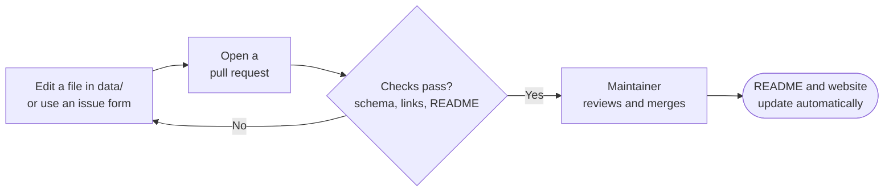

<!-- END:diagram:contribute -->

**Become a contributor:**

- ➕ [Suggest a tool](https://github.com/NeuralSaasAi/vibe-coding-hub/issues/new?template=add-tool.yml)
- 💲 [Report a price change](https://github.com/NeuralSaasAi/vibe-coding-hub/issues/new?template=pricing-update.yml)
- 🔗 [Report a broken link](https://github.com/NeuralSaasAi/vibe-coding-hub/issues/new?template=broken-link.yml)

<!-- BEGIN:recently-verified -->

**Recently verified:** Base44 (2026-11), Bolt (2026-11), ChatGPT (Codex) (2026-11), Claude (Claude Code) (2026-11) and Clerk (2026-11). Help keep it fresh: [send a pricing update](https://github.com/NeuralSaasAi/vibe-coding-hub/issues/new?template=pricing-update.yml).

<!-- END:recently-verified -->

<p align="center">
  <a href="https://github.com/NeuralSaasAi/vibe-coding-hub/graphs/contributors">
    
  </a>
</p>

<p align="center">
  <a href="https://www.star-history.com/#NeuralSaasAi/vibe-coding-hub&amp;Date">
    <picture>
      <source media="(prefers-color-scheme: dark)" srcset="https://api.star-history.com/svg?repos=NeuralSaasAi/vibe-coding-hub&amp;type=Date&amp;theme=dark">
      
    </picture>
  </a>
</p>

<p align="right"><a href="#top">↑ back to top</a></p>

## 🙏 Credits

This list was written from vendor pages and official docs. These projects helped us find tools and shaped the format:

- [awesome-vibe-coding](https://github.com/filipecalegario/awesome-vibe-coding) by Filipe Calegario
- [The Vibe Coding Handbook](https://github.com/hacrex/the-vibe-coding-handbook)
- [Awesome](https://github.com/sindresorhus/awesome) by Sindre Sorhus, for the awesome-list conventions
- [Simple Icons](https://simpleicons.org) for the logo glyphs. Brand names and logos belong to their owners.

## 💜 Maintained by NeuralSaaS

<p align="center">
  <a href="https://neuralsaasai.com/contact?utm_source=github&amp;utm_medium=readme&amp;utm_campaign=vibe-coding-hub&amp;utm_content=footer-card">
    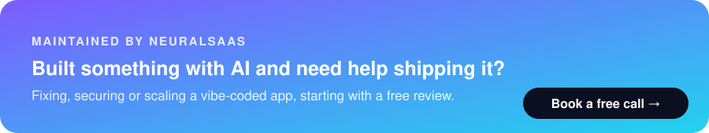
  </a>
</p>

This list is maintained by [NeuralSaaS](https://neuralsaasai.com/?utm_source=github&utm_medium=readme&utm_campaign=vibe-coding-hub). Tools are listed on merit, and nobody pays to be included.

Built something with AI and need help shipping, fixing or scaling it? [Book a free discovery call](https://neuralsaasai.com/contact?utm_source=github&utm_medium=readme&utm_campaign=vibe-coding-hub).

Released under [CC0 1.0](LICENSE). Use it however you like.
